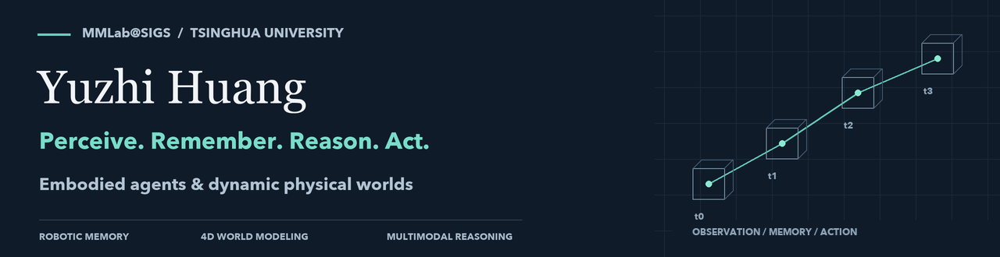

### Hi, I'm Yuzhi Huang · 黄誉之

I'm a Ph.D. student at **Tsinghua Shenzhen International Graduate School**, working with the [Self-Evolving Embodied Agents Group at MMLab@SIGS](https://mmlab-sigs.github.io/groups/self-evolving-embodied-agents-group/), co-supervised by [Prof. Zhi Wang](http://zwang.inflexionlab.org/) and [Dr. Jingyan Jiang](https://www.jiangjingyan.com/).

I study how embodied agents can **understand changing physical worlds and turn observations into reliable actions**. My work connects spatio-temporal memory for robotic planning, 4D world modeling, and multimodal reasoning and evaluation.

**[Website & publications](https://yu2hi13.github.io/) · [Google Scholar](https://scholar.google.com/citations?user=XgWSoXkAAAAJ) · [Hugging Face](https://huggingface.co/yu2hi13) · [Email](mailto:yz_huang13@163.com)**

### Selected research

| Project | Focus | Venue | Explore |
| :--- | :--- | :--- | :--- |
| **RoboStream** | Spatio-temporal memory for long-horizon robotic planning | ECCV 2026 | [Project](https://robostream123.github.io/) · [Code](https://github.com/yu2hi13/RoboStream) |
| **Thinking in Dynamics** | Evaluating how MLLMs perceive, track, and reason about physical dynamics | CVPR 2026 | [Project](https://dyn-bench.github.io/) · [Code](https://github.com/Dynamics-X/Thinking-in-Dynamics) · [Data](https://huggingface.co/datasets/yu2hi13/Dyn-Bench) |
| **DynamicVerse** | Physically-aware multimodal modeling of dynamic 4D worlds | NeurIPS 2025 | [Project](https://dynamic-verse.github.io/) · [Code](https://github.com/Dynamics-X/DynamicVerse) |
| **DynTrace** | Tracking dynamic object evidence for 4D reasoning in MLLMs | ACM MM 2026 | [Project](https://dyntrace.github.io/) · [Paper](https://arxiv.org/abs/2607.12503) |
| **TAO** | Detecting and tracking anomalous objects in videos | CVPR 2025 | [Project](https://tao-25.github.io/) · [Code](https://github.com/yu2hi13/TAO) |
| **ChainVLA** | Linking VLA queries through a shared execution state | Preprint, 2026 | [Project](https://muqy1818.github.io/chainvla-web/) |

Earlier work includes **[ASAM](https://a-sa-m.github.io/)** (NeurIPS 2024) and **[P²SAM](https://p2-sam.github.io/)** (ACM MM 2024), exploring ambiguity-aware segmentation with vision foundation models.

<b>More collaborations</b>

- [RobotWorld](https://robotworldai.github.io/) — benchmarking multimodal agents for robot use across tasks and embodiments.
- [ChunkTrust](https://hf618.github.io/ChunkTrust.github.io/) — adapting execution horizons for robot foundation policies.
- [Zip-VGGT](https://zipvggt.github.io/) — object-centric spatiotemporal KV compression for streaming vision transformers.
- [TAU-Bench](https://yarkupa.github.io/tau-bench.github.io/) — from anomaly instance tracking to fine-grained video anomaly understanding.

### Let's connect

I'm happy to discuss research and open-source collaborations on **embodied AI, dynamic-world understanding, and multimodal reasoning**. Reach me at [yz_huang13@163.com](mailto:yz_huang13@163.com).

Interested in undergraduate research with our group? Please see the [application information and submission channel](https://mmlabsigs.notion.site/mmlab).
