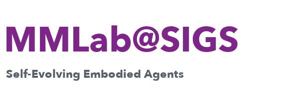

<h1 align="center">
  Hi, I'm <a href="https://yu2hi13.github.io/">Yuzhi Huang (黄誉之)</a> 👋
</h1>

  
  

  <a href="https://www.sigs.tsinghua.edu.cn/">
    <picture>
      <source media="(prefers-color-scheme: dark)" srcset="assets/tsinghua-sigs-dark.png">
      <source media="(prefers-color-scheme: light)" srcset="assets/tsinghua-sigs-light.png">
      
    </picture>
  </a>
  &nbsp;&nbsp;
  <a href="https://mmlab-sigs.github.io/groups/self-evolving-embodied-agents-group/">
    <picture>
      <source media="(prefers-color-scheme: dark)" srcset="assets/mmlab-wordmark-dark.png">
      <source media="(prefers-color-scheme: light)" srcset="assets/mmlab-wordmark-light.png">
      
    </picture>
  </a>

### 🏠 Homepage: [yu2hi13.github.io](https://yu2hi13.github.io/)

**🚀 Building embodied agents that understand a changing world.**

Hi! I am **Yuzhi Huang (黄誉之)**, a Ph.D. student at **Tsinghua Shenzhen International Graduate School** and a member of the [Self-Evolving Embodied Agents Group at **MMLab@SIGS**](https://mmlab-sigs.github.io/groups/self-evolving-embodied-agents-group/), co-supervised by [Prof. **Zhi Wang**](http://zwang.inflexionlab.org/) and [Dr. **Jingyan Jiang**](https://www.jiangjingyan.com/).

My research focuses on **Embodied AI, 4D World Modeling, and Multimodal Dynamic Reasoning**. I am interested in how agents can build persistent memories, reason about evolving physical scenes, and carry out long-horizon tasks. My recent work spans memory-augmented robotic planning (**RoboStream**), dynamic-world evaluation (**Thinking in Dynamics / Dyn-Bench**), and physically-aware 4D modeling (**DynamicVerse**).

I have published first/co-first-author papers at **CVPR, NeurIPS, ECCV, and ACM MM**, including **Thinking in Dynamics**, which was selected for an **oral presentation at the CVPR 2026 DataMFM Workshop**. I was selected for the **2026 Young Science and Technology Talent Cultivation Program (Doctoral Track)** of the **China Association for Science and Technology (CAST)** and received the **Tsinghua Future Scholar Scholarship (2026)**.

<b>中文介绍</b>

你好！我是**黄誉之**，清华大学深圳国际研究生院博士生，MMLab@SIGS **Self-Evolving Embodied Agents Group** 成员，由 **Zhi Wang 教授**和 **Jingyan Jiang 博士**共同指导。我的研究聚焦于**具身智能、四维世界建模与多模态动态推理**，希望让智能体能够理解变化的物理环境、记住关键状态，并完成长时程任务。相关成果发表于 CVPR、NeurIPS、ECCV 和 ACM MM。入选**2026年度中国科协青年科技人才培育工程博士生专项计划**，曾获清华大学“未来学者”奖学金。欢迎交流与合作！

*Feel free to reach out for research discussions and collaborations!*

  
  
  
  
  

# 📑 Papers

> See [Google Scholar](https://scholar.google.com/citations?user=XgWSoXkAAAAJ) or [my homepage](https://yu2hi13.github.io/#publications) for the full publication list.

## First / Co-first Author

- **[Preprint 2026]** **ChainVLA**: Chaining Vision-Language-Action Queries through a Unified Execution State for Long-Horizon Manipulation. [Webpage](https://muqy1818.github.io/chainvla-web/)
- **[ECCV 2026]** **RoboStream**: Weaving Spatio-Temporal Reasoning with Memory in Vision-Language Models for Robotics. [Webpage](https://robostream123.github.io/) / [Paper](https://arxiv.org/abs/2603.12939) / [Code](https://github.com/yu2hi13/RoboStream)
- **[CVPR 2026]** **Thinking in Dynamics**: How Multimodal Large Language Models Perceive, Track, and Reason Dynamics in Physical 4D World. [Webpage](https://dyn-bench.github.io/) / [Paper](https://arxiv.org/abs/2603.12746) / [Code](https://github.com/Dynamics-X/Thinking-in-Dynamics) / [Dataset](https://huggingface.co/datasets/yu2hi13/Dyn-Bench) · 🎤 **DataMFM Workshop Oral**
- **[ACM MM 2026]** **DynTrace**: Tracking Dynamic Object Evidence for 4D Spatio-Temporal Reasoning in MLLMs. [Webpage](https://dyntrace.github.io/) / [Paper](https://arxiv.org/abs/2607.12503)
- **[NeurIPS 2025]** **DynamicVerse**: Physically-Aware Multimodal Modeling for Dynamic 4D Worlds. [Webpage](https://dynamic-verse.github.io/) / [Paper](https://arxiv.org/abs/2512.03000) / [Code](https://github.com/Dynamics-X/DynamicVerse)
- **[CVPR 2025]** **TAO**: Track Any Anomalous Object: A Granular Video Anomaly Detection Pipeline. [Webpage](https://tao-25.github.io/) / [Paper](https://arxiv.org/abs/2506.05175) / [Code](https://github.com/yu2hi13/TAO)
- **[NeurIPS 2024]** **ASAM**: Flaws can be Applause: Unleashing Potential of Segmenting Ambiguous Objects in SAM. [Webpage](https://a-sa-m.github.io/) / [Paper](https://openreview.net/pdf?id=vJSNsSFO95) / [Code](https://github.com/chenxinli001/a2sam)
- **[ACM MM 2024]** **P²SAM**: Probabilistically Prompted SAMs Are Efficient Segmentators for Ambiguous Medical Images. [Webpage](https://p2-sam.github.io/) / [Paper](https://dl.acm.org/doi/10.1145/3664647.3680628) / [Code](https://github.com/yu2hi13/P2SAM)

## Selected Collaborations

- **RobotWorld** — Benchmarking multimodal agents for robot use. [Webpage](https://robotworldai.github.io/) / [Paper](https://arxiv.org/abs/2610.10409) / [Code](https://github.com/robotworldai/robotworld)
- **ChunkTrust** — Adaptive execution horizons for robot foundation policies. [Webpage](https://hf618.github.io/ChunkTrust.github.io/) / [Paper](https://arxiv.org/abs/2609.39754) / [Code](https://github.com/hf618/ChunkTrust)
- **Zip-VGGT** — Object-centric spatiotemporal KV compression for streaming vision transformers. [Webpage](https://zipvggt.github.io/)
- **TAU-Bench** — From anomaly instance tracking to fine-grained video anomaly understanding. [Webpage](https://yarkupa.github.io/tau-bench.github.io/) / [Paper](https://arxiv.org/abs/2608.05699)

# 📦 Open-source Projects

- **[RoboStream](https://github.com/yu2hi13/RoboStream)** — Persistent spatio-temporal memory for robotic planners. 
- **[Thinking in Dynamics](https://github.com/Dynamics-X/Thinking-in-Dynamics)** — A benchmark for physical 4D world understanding. 
- **[DynamicVerse](https://github.com/Dynamics-X/DynamicVerse)** — Physically-aware multimodal 4D modeling. 
- **[TAO](https://github.com/yu2hi13/TAO)** — Tracking anomalous objects in videos. 

---

🎓 Interested in undergraduate research with our group? Please apply through the [MMLab@SIGS application portal](https://mmlabsigs.notion.site/mmlab).
